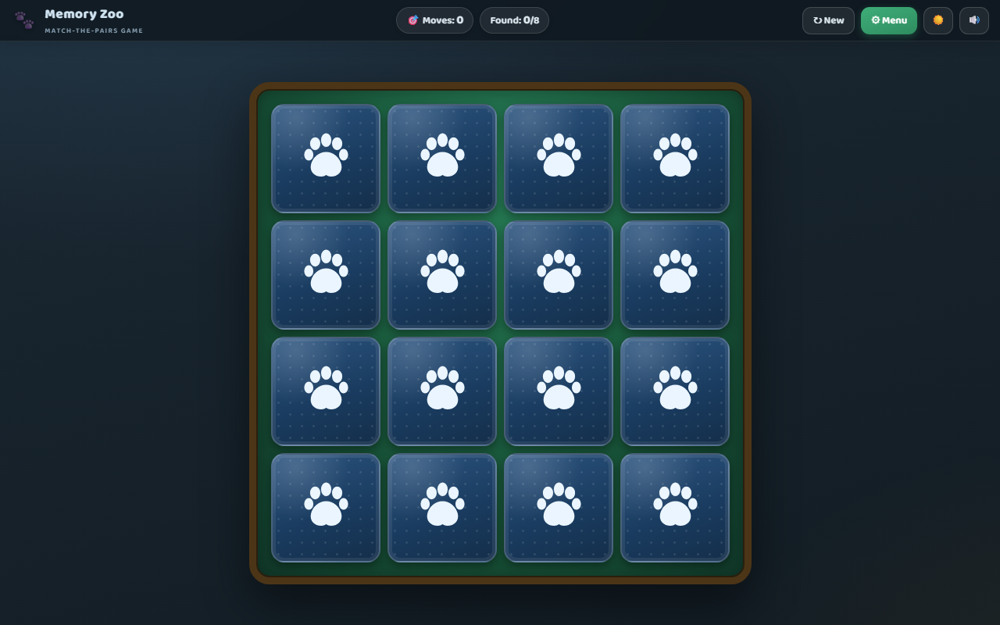
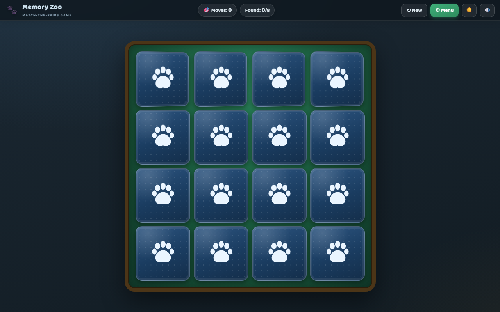

# Memory Zoo — match-the-pairs web game

A kids' memory game: a top-down board of square cards, all picture-side down.
Pick two cards — if they show the same animal they come off the board, if not
they turn back face-down.

 

## Run it

Just open **`index.html`** in any modern browser (double-click it — no server
or build step needed; all assets are local files).

The game starts in a **dark theme** by default; the ☀️/🌙 button in the top
bar switches between the dark and light palettes (choice is remembered).

## Game modes (choose in ⚙ Menu)

### 🧑 Solo
- Flip two cards; a match removes them and you continue.
- The score is the **total number of pair-attempts (moves)** — fewer is better.
- High scores are stored in the browser (localStorage) **for each exact
  "total cards × pictures" combination** — e.g. 48×6, 48×10 and 24×6 each
  keep their own record. All records are listed in the menu.

### 🤖 vs Computer
- Take turns. A match means the same player goes again; a miss turns both
  cards back over and passes the turn.
- The computer's difficulty (all adjustable, plus Easy/Normal/Hard presets):
  - **Remember chance:** 50–95 % per shown card. It tries to remember the
    location of every card revealed during play (its own *and* the player's).
  - **Memory size:** 3–7 cards. A newly remembered card evicts a random old
    memory entry.
- Computer pick strategy (as specified):
  1. if its memory contains a matching pair → take those two cards;
  2. else flip one card it does *not* remember; if it remembers that picture
     elsewhere on the board, flip that card;
  3. else flip the second card at random.
- Whoever took more pairs off the board wins (draw is possible).

## Settings
- **Total cards:** even numbers, 10–48.
- **Pictures used:** 4–12 of the 12 animal sprites in `TileSprites/animals/`.
- **Card back color:** blue (default), burgundy, dark brown, forest green,
  plum or slate — chosen from swatches in the menu, previewed live on the
  board behind it, remembered in settings. The paw design, dot pattern and
  animations stay identical; only the cloth color changes. Works in both
  light and dark themes.
- Pictures are used in **evenly split pairs**: with `pairs = total/2` and
  `n` pictures, each picture gets `floor(pairs/n)` pairs and the first
  `pairs mod n` pictures get one extra. Example: 28 cards with 5 pictures →
  pairs 3,3,3,3,2 → cards **6,6,6,6,4** (note: the request's example
  6+6+6+4+4 = 26 doesn't add up to 28; this game always sums exactly to the
  chosen total and never uses an odd count of a picture).
- Board layout picks near-square / nice-rectangle grids (46 cards → 8×6 with
  two random empty spots, etc.).

## Files
| File | Purpose |
|---|---|
| `index.html` | game page (HUD, board, settings menu, results) |
| `style.css` | felt board, paw-print card backs, flip/match/shake animations, menu |
| `game.js` | game logic, computer AI, high scores, WebAudio sound effects |
| `test_headless.js` | dev smoke-test: plays full games in a stub DOM (`node test_headless.js '{"mode":"vs","total":16,"images":6}'`) |
| `TileSprites/animals/` | the 12 card pictures (drop in more PNGs and add an entry in `SPRITES` at the top of `game.js` to use them) |
| `qa_*.png` | visual QA screenshots (safe to delete) |

Extras: sound on/off toggle (synthesized, no audio files), dark/light theme
toggle, Esc closes dialogs, responsive layout for smaller screens,
`index.html?qa=menu` / `?qa=faces` / `?qa=light` / `?back=burgundy` debug
views used for the screenshots above.
