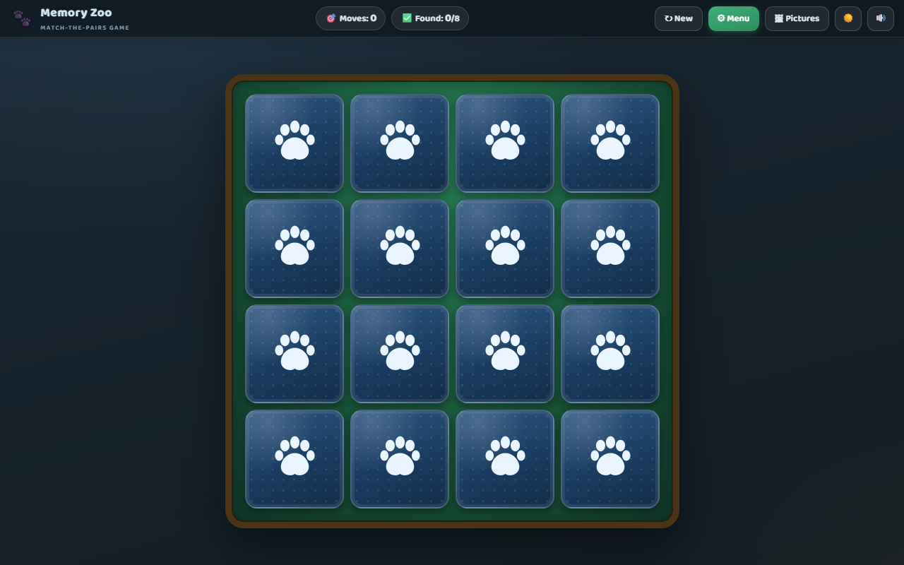
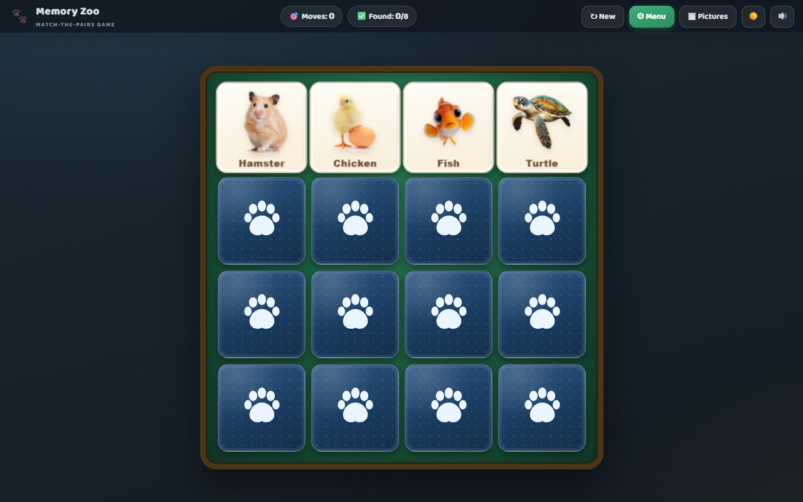
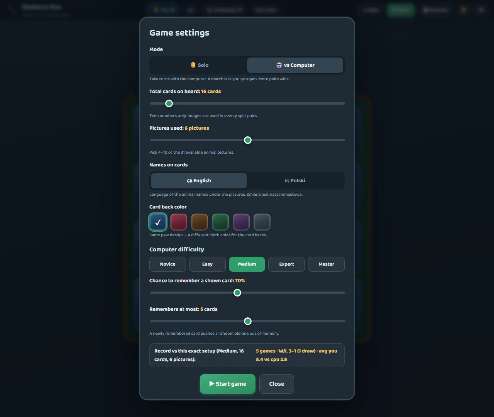
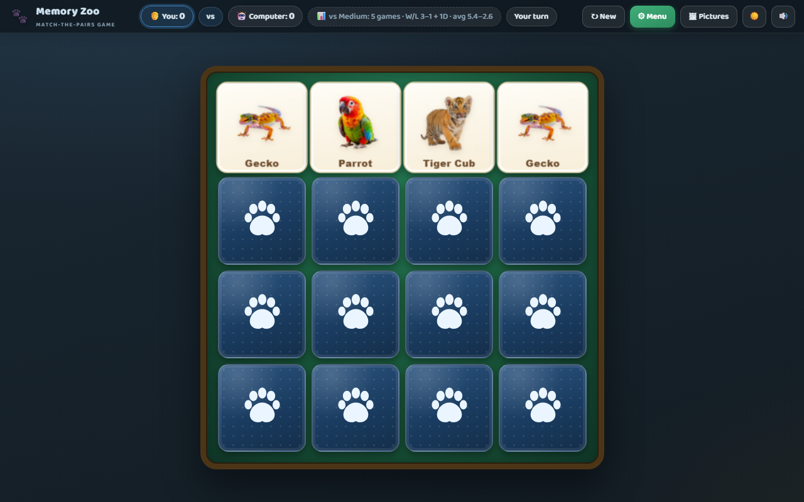
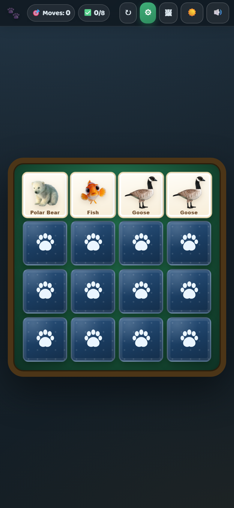
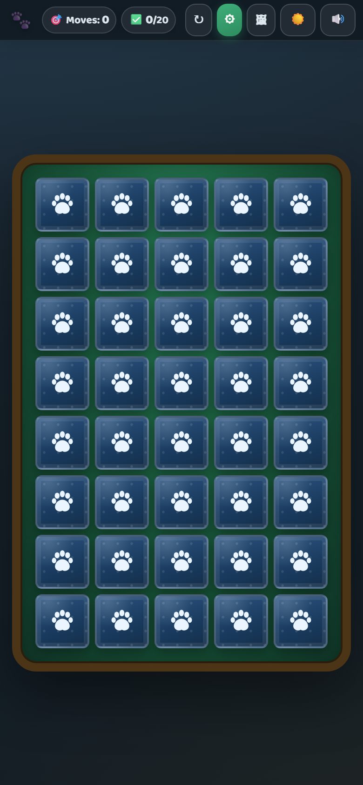
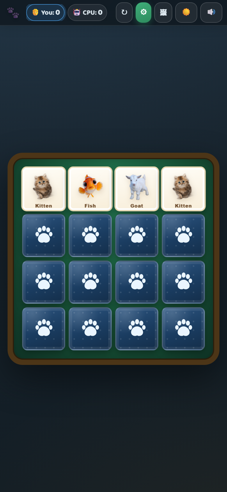

# Memory Zoo — match-the-pairs web game

A kids' memory game: a top-down board of square cards, all picture-side down.
Pick two cards — if they show the same animal they come off the board, if not
they turn back face-down.

**▶ Play it right now: <https://logoth80.github.io/memory-zoo/>**

 

## Run it

Just open **`index.html`** in any modern browser (double-click it — no server
or build step needed; all assets are local files).

Or serve it straight from GitHub Pages: the site above is published from
this repository's `main` branch (Settings → Pages → *Deploy from a branch*),
so every push to `main` redeploys it in about a minute.

Note: high scores, records and settings live in the browser's localStorage
**per origin** — scores earned while playing the local `index.html` and
scores earned on the GitHub Pages site are separate, and on the public site
each visitor keeps their own records in their own browser.

The game starts in a **dark theme** by default; the ☀️/🌙 button in the top
bar switches between the dark and light palettes (choice is remembered).

## Game modes (choose in ⚙ Menu)

### 🧑 Solo
- Flip two cards; a match removes them and you continue.
- The score is the **total number of pair-attempts (moves)** — fewer is better.
- High scores are stored in the browser (localStorage) **for each exact
  "total cards × pictures" combination** — e.g. 48×6, 48×10 and 24×6 each
  keep their own record. The menu shows only the best for the currently
  selected setup (solo mode only; all other records stay stored).

### 🤖 vs Computer
- Take turns. A match means the same player goes again; a miss turns both
  cards back over and passes the turn.
- The computer's difficulty is exactly five presets
  (**Novice 50 %/3 · Easy 60 %/4 · Medium 70 %/5 · Expert 80 %/6 ·
  Master 90 %/7**) — there is nothing to fine-tune; the menu only *shows*
  what the selected preset does:
  - **Remember chance:** per shown card, the computer tries to remember the
    location of every card revealed during play (its own *and* the player's).
  - **Memory size:** in cards. A newly remembered card evicts a random old
    memory entry.
  Switching difficulty mid-game takes effect immediately — the AI and the
  record chip follow the new preset. (Old saves from the removed sliders
  migrate to the preset they matched, otherwise to Medium.)
- Computer pick strategy (as specified):
  1. if its memory contains a matching pair → take those two cards;
  2. else flip one card it does *not* remember; if it remembers that picture
     elsewhere on the board, flip that card;
  3. else flip the second card at random.
- Whoever took more pairs off the board wins (draw is possible).
- **Per-setup records:** every finished vs game is tracked for the exact
  **difficulty preset × total cards × pictures** combination (records exist
  only for the five standard difficulties — there are no custom slider
  settings anymore). The record shows **games played, W/L (draws noted) and
  the average pair-score you vs the computer**. It is displayed twice: as a
  dashed chip in the top bar **during play** (for the exact setup being
  played, once at least one game finished) and as a row in the menu for the
  currently selected setup; the end-of-game popup repeats the totals updated
  with the game just played.  

## Settings
- **Total cards:** even numbers, 10–62.
- **Pictures used:** 4–10, drawn from the 31 animal sprites in `TileSprites/animals/`.
- **Choose pictures:** the 🖼 **Pictures** button in the top bar opens every picture;
  click one to cross it out — crossed-out animals are never dealt into games.
  At least 10 pictures must stay available (the last 10 refuse to be crossed
  out). The choice is remembered; "Show all" restores everything.
- **Names on cards:** English or Polski — a language segment in the menu;
  every card carries both labels (`name` / `pl` in `SPRITES`), the switch
  updates cards on the board immediately and is remembered in settings.
- **Card back color:** blue (default), burgundy, dark brown, forest green,
  plum or slate — chosen from swatches in the menu, previewed live on the
  board behind it, remembered in settings. The paw design, dot pattern and
  animations stay identical; only the cloth color changes. Works in both
  light and dark themes.
- Pictures are used in **evenly split pairs**: with `pairs = total/2` and
  `n` pictures, each picture gets `floor(pairs/n)` pairs and the first
  `pairs mod n` pictures get one extra. Example: 28 cards with 5 pictures →
  pairs 3,3,3,3,2 → cards **6,6,6,6,4** (note: the request's example
  6+6+6+4+4 = 26 doesn't add up to 28; this game always sums exactly to the
  chosen total and never uses an odd count of a picture).
- Board layout checks the screen **on every new game**: landscape screens get
  wide grids, portrait screens get tall ones (40 cards → 5×8 on a phone,
  8×5 on a desktop). Exact factors are preferred with a pleasant aspect;
  otherwise near-square grids with a few random empty spots (46 cards → 8×6
  with two holes, 62 cards → 9×7 with one, etc.).

### Phone (portrait) mode

Held vertically on a narrow screen the game reorganizes itself:

- the top bar stays **one slim line** — the game name is hidden and only
  the essentials remain: score chips ("Found:" collapses to ✅ 0/8,
  "Computer" to CPU) and icon-only buttons;
- the record chip and the "Computer thinking…" text are hidden (whose turn
  it is still shows as the glowing active player chip) — so nothing wraps
  to a second line and the board never gets pushed down;
- new games use tall grids as above, sized to the visible area.

  

## Files
| File | Purpose |
|---|---|
| `index.html` | game page (HUD, board, settings menu, results) |
| `style.css` | felt board, paw-print card backs, flip/match/shake animations, menu |
| `game.js` | game logic, computer AI, high scores, WebAudio sound effects |
| `test_headless.js` | dev smoke-test: plays full games in a stub DOM (`node test_headless.js '{"mode":"vs","total":16,"images":6}'`) |
| `qa_shoot.js` | dev helper: exact-size browser screenshots via CDP device metrics — headless `--window-size` can't go below ~500 px wide, phones can (`node qa_shoot.js out.png <url> 390 844`) |
| `TileSprites/animals/` | the 31 card pictures (drop in more PNGs and add an entry with `id`, English `name` and Polish `pl` to `SPRITES` at the top of `game.js` to use them) |
| `prepare_sprites.py` | dev helper: cuts raw photos from `TileSprites/raw/` into transparent, square `*01.png` sprites (`python prepare_sprites.py`) |
| `qa_*.png` | visual QA screenshots (safe to delete) |

Extras: sound on/off toggle (synthesized, no audio files), dark/light theme
toggle, Esc closes dialogs, responsive layout for smaller screens,
`index.html?qa=menu` / `?qa=pics` / `?qa=faces` / `?qa=all` / `?qa=light` / `?qa=dbg` (dumps the board-layout budget into a toast) /
`?back=burgundy` / `?mode=vs` / `?total=62` / `?images=10` / `?lang=pl` /
`?block=Panda01,Wolf01` / `?vsdemo=1` (seeds a demo vs record) debug views
used for the screenshots above.
